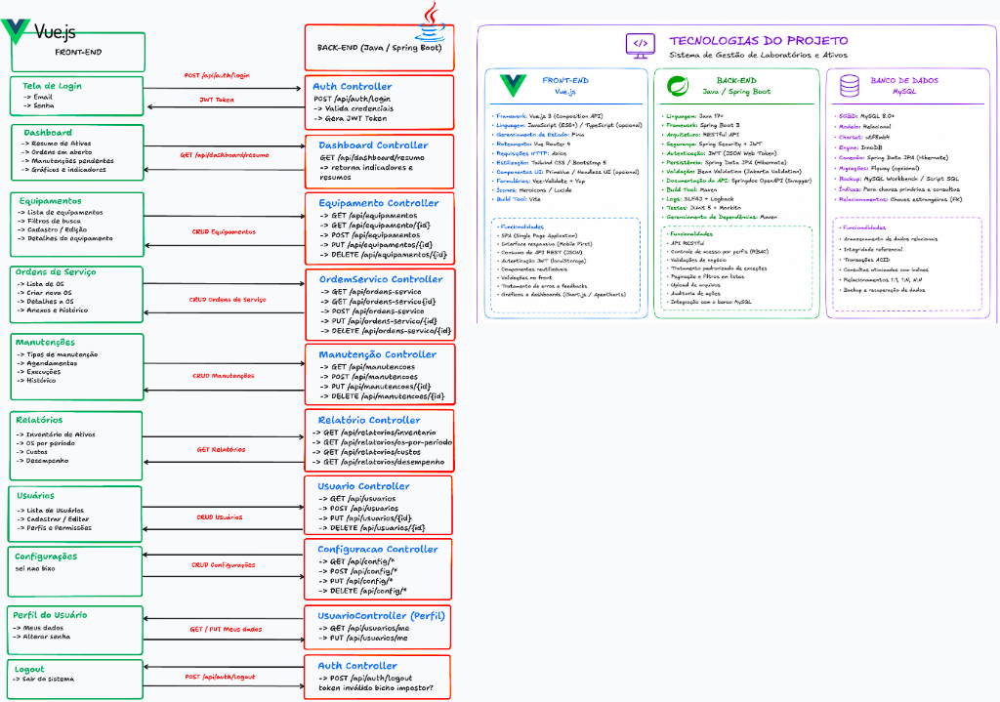

# STOCKA — Sistema de Gestão de Laboratórios, Ativos e Ambientes

O **STOCKA** é uma solução completa para gestão patrimonial, controle de estoque, ordens de serviço e manutenção de ativos em salas e setores laboratoriais/industriais. Desenvolvido com uma arquitetura moderna dividida entre **Frontend SPA (Vue 3)**, **API RESTful (Java / Spring Boot)** e banco de dados relacional.

---

## 🗺️ Visão Arquitetural e Minimap de Tecnologias

Abaixo está o mapa de integração e as tecnologias fundamentais que compõem o ecossistema do **STOCKA**:



### 📊 Stack Tecnológica

| Camada | Tecnologias Principais | Funcionalidades e Características |
|---|---|---|
| **Front-End** | **Vue.js 3** (Composition API)<br>• **TypeScript**<br>• **Pinia** (Gerenciamento de Estado)<br>• **Vue Router 4** (Navegação SPA)<br>• **Vite** (Build Tool)<br>• **Lucide Icons** (`@lucide/vue`) | • Single Page Application (SPA)<br>• Interface Responsiva (*Mobile-First* & Desktop)<br>• Identidade visual mineral com acento terracota<br>• Slideshow dinâmico e feedback visual interativo<br>• Consumo de API REST com tratamento de sessão |
| **Back-End** | **Java 21 LTS**<br>• **Spring Boot 3**<br>• **HikariCP** (Pool de Conexões)<br>• **BCrypt** (Criptografia de Senhas)<br>• **SLF4J + Logback**<br>• **JUnit 5** (Testes Automatizados) | • API RESTful estruturada em camadas<br>• Autenticação e sessão com cookies seguros HttpOnly<br>• Controle de acesso por perfil (RBAC: Administrador / Usuário)<br>• Validações de negócio e concorrência otimista (versão)<br>• Auditoria atômica de cadastros e alterações |
| **Banco de Dados** | **PostgreSQL 16** / **MySQL 8.0+**<br>• Engine transacional ACID<br>• Charset UTF-8 / utf8mb4 | • Integridade referencial com Chaves Primárias (PK) e Estrangeiras (FK)<br>• Scripts versionados de migração e testes isolados<br>• Script de carga rápida com dados fictícios (`Popular-Banco.ps1`) |

## Organização

| Pasta ou arquivo | Responsabilidade |
|---|---|
| frontend/ | Login, hub e inventário com identidade Industrial, integrados à API. |
| backend/ | API Java: autenticação, ambientes/acessos, cadastro e consulta do inventário. |
| database/ | Estrutura SQL, dados fictícios, consultas, testes e conexão do pgAdmin. |
| docs/ | Guias atuais do projeto e modelo do banco. |
| compose.yaml | Execução local do PostgreSQL e do pgAdmin pelo Docker. |
| .env e backend/.env | Configurações locais; ficam fora do Git. |

## 🚀 Como Executar o Projeto

### Pré-requisitos
- **Java JDK 21** ou superior
- **Node.js 22+** ou superior
- **Docker Desktop** (para execução dos serviços de banco de dados)
- Shell **PowerShell** (ambiente Windows)

### 1. Iniciar Banco de Dados e Serviços
No terminal da raiz do projeto, execute:
```powershell
.\Iniciar-Banco.ps1
```
> O PostgreSQL iniciará na porta `15432` e o pgAdmin em `http://localhost:15050`.

### 2. Iniciar a API Java (Back-End)
Em um terminal dedicado na raiz:
```powershell
.\Iniciar-API.ps1
```
> A API estará pronta para receber requisições em `http://localhost:8080`.

### 3. Iniciar a Interface Web (Front-End)
Em outro terminal:
```powershell
cd frontend
npm install
npm run dev
```
> Acesse a interface web em `http://localhost:5173`.

---

## 🛠️ Scripts e Utilitários PowerShell

| Script na Raiz | Descrição |
|---|---|
| `.\Iniciar-Banco.ps1` | Inicia o contêiner do PostgreSQL e o serviço do pgAdmin. |
| `.\Atualizar-Banco.ps1` | Aplica migrações pendentes sem perda de dados. |
| `.\Popular-Banco.ps1` | Insere dados fictícios (ambientes e itens de demonstração). |
| `.\Parar-Banco.ps1` | Encerra os serviços do banco preservando os volumes. |
| `.\Iniciar-API.ps1` | Compila e sobe a API Spring Boot em tempo de execução. |
| `.\Parar-API.ps1` | Finaliza os processos Java da API deste projeto. |
| `.\Testar-Backend.ps1` | Executa a suíte de testes automatizados da API. |
| `.\Testar-Banco.ps1` | Valida restrições e integridade relacional no banco local. |
| `.\Testar-Inventario.ps1` | Executa testes do fluxo de inventário em banco temporário. |


## Estado atual

- O banco contém usuários, ambientes e atribuições entre eles.
- O inventário contém itens e auditoria automática, com foto opcional e responsabilidade separada da localização.
- A API oferece login, consulta da conta, logout, listagem, cadastro e edição de ambientes e gerenciamento de atribuições.
- A senha é conferida com BCrypt; a sessão usa cookie HttpOnly.
- Ambos os perfis podem alterar a própria senha no hub, informando a senha atual e respeitando RF03/RN06. Veja [o guia](docs/alteracao-senha.md).
- O login Vue está integrado à API, com identidade Industrial, recuperação da sessão e saída.
- O hub lista salas e setores autorizados e permite pesquisar por nome, tipo ou descrição.
- Administradores cadastram/editam ambientes, escolhem sua cor e atribuem/revogam acessos de usuários. A API verifica o perfil em cada ação.
- Retirada de ambientes ainda exige implementar as verificações da RN05; não há exclusão disponível.

O fluxo completo será: Vue envia requisições à API Java; o Java verifica a conta
e as permissões, consulta PostgreSQL e devolve os dados que a interface apresenta.

## Documentação e próximos passos

Comece pelo [índice da documentação](docs/README.md). Os guias descrevem a versão
atual; o material do protótipo e os guias substituídos foram arquivados fora do projeto.
A ERS revisada continua sendo a referência de requisitos e ainda precisa ser
incluída no repositório na versão aprovada pelo grupo.

O login Industrial já está integrado à API. Consulte [o guia do frontend](docs/frontend.md).
A base do hub e o primeiro inventário estão funcionais: abra um ambiente para listar,
pesquisar, cadastrar e editar itens/status, consultar foto e auditoria. Localização e setor responsável
são distintos. Veja [o guia do inventário](docs/inventario.md) e o registro de
[decisões e próximos passos](docs/decisoes-e-proximos-passos.md). Exclusão,
movimentação segue para incremento posterior; registro e consulta de manutenção estão disponíveis. Abertura, consulta, andamento e encerramento de OS
para equipamentos já estão disponíveis.

As pastas target, node_modules e dist, quando presentes, são geradas pelas
ferramentas e ficam fora do Git. Não representam código que o grupo precisa manter.

Para acrescentar quatro ambientes DEMO e 12 itens fictícios ao banco local, com a API
ativa, execute .\Popular-Banco.ps1 na raiz. Reexecução não duplica os exemplos.
Veja [Edição e demonstração](docs/edicao-e-demonstracao.md) para funcionamento e limites.

Consulte [Ordens de serviço](docs/ordens-servico.md) para abertura, consulta e escopo atual.

Registro e histórico de manutenção, indicadores por status e contagens de OS estão
em [Manutenções e leitura do inventário](docs/manutencoes.md).

Itens agora permitem exclusão lógica com confirmação, auditoria e consulta administrativa.
Veja [Exclusão de itens](docs/exclusao-itens.md). Retirada de ambientes e desativação de usuários seguem pendentes.


## 📌 Regras de Negócio Fundamentais

- **Localização Física vs Setor Responsável**: Um equipamento possui uma única localização física atual (onde está guardado ou em uso) e um setor responsável pelo patrimônio. A responsabilidade não duplica o registro nem concede acesso ao inventário de outros ambientes ([RN03/RN09/RN17](docs/decisoes-e-proximos-passos.md)).
- **Retirada de Ambientes**: Salas e setores só podem ser retirados de uso caso não possuam itens vinculados ou vínculos ativos de responsabilidade ([RN05](docs/retirada-ambientes.md)).
- **Controle de Concorrência e Auditoria**: Modificações em itens e ambientes utilizam checagem de versão (`versao`) com gravação atômica de autoria e data do servidor.
- **Autenticação Segura**: Senhas protegidas com BCrypt; sessões gerenciadas por cookies protegidos com sinalizadores de segurança.

---

## 📚 Documentação Adicional

Para aprofundar-se nos detalhes de cada módulo, consulte a pasta [`docs/`](docs/README.md):
- [Decisões e Próximos Passos](docs/decisoes-e-proximos-passos.md)
- [Guia do Frontend](docs/frontend.md)
- [Guia do Backend](docs/backend.md)
- [Gestão de Usuários](docs/gestao-usuarios.md)
- [Ordens de Serviço](docs/ordens-servico.md)
- [Histórico e Manutenções](docs/manutencoes.md)
- [Retirada de Ambientes](docs/retirada-ambientes.md)
- [Exclusão Lógica de Itens](docs/exclusao-itens.md)
