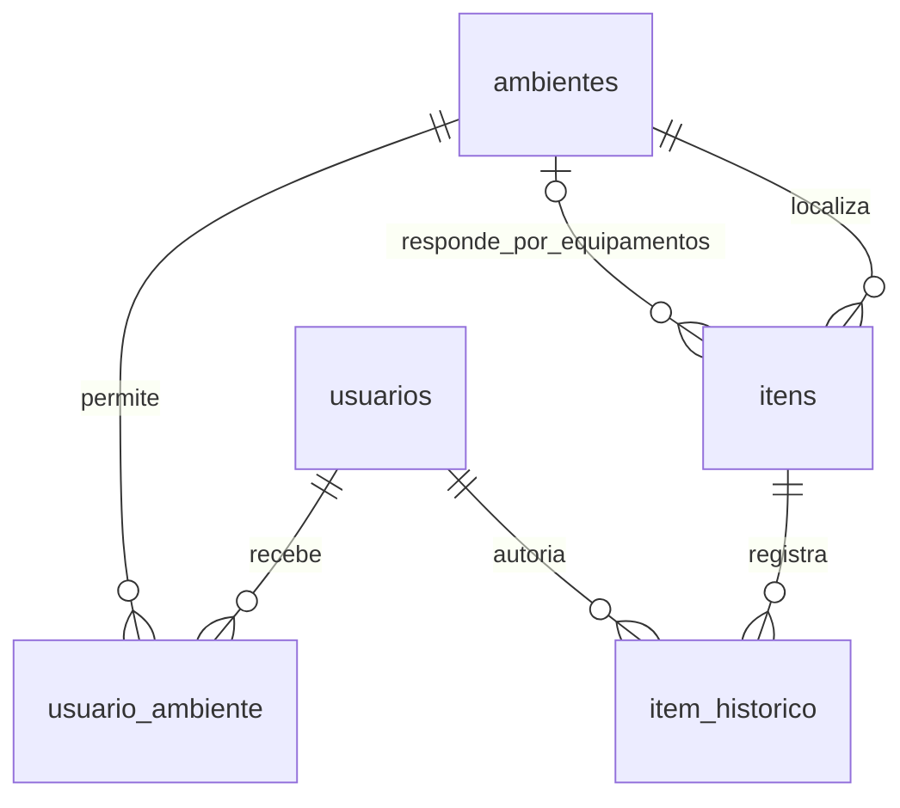

# Modelo do banco STOCKA

Este modelo ja acompanha o SQL implementado. O banco completo sera construido
em incrementos, sem alterar a instancia Supabase do grupo.

## Chaves e relacionamentos

PK identifica uma linha. FK referencia uma linha de outra tabela.

Um usuario pode ter zero ou varios ambientes, e um ambiente pode ter zero ou varios
usuarios. `usuario_ambiente` representa essa relacao N:N. O Administrador tem
acesso geral e nao depende de atribuicoes.

## usuarios

| Campo | Tipo | Papel |
|---|---|---|
| id | bigint identity | PK gerada pelo PostgreSQL. |
| nome | varchar(120) | Nome obrigatorio. |
| login | varchar(254) | Identificador unico de acesso; aceita o e-mail/login previsto na ERS. |
| senha_hash | text | Hash da senha; a senha original nao e armazenada. |
| perfil | varchar(20) | ADMINISTRADOR ou USUARIO. |
| ativo | boolean | Permite retirar acesso sem apagar a autoria anterior. |
| criado_em | timestamptz | Data e hora de criacao com informacao de fuso. |

## ambientes

| Campo | Tipo | Papel |
|---|---|---|
| id | bigint identity | PK gerada pelo PostgreSQL. |
| nome | varchar(120) | Nome unico, conforme RN02. |
| descricao | text | Descricao opcional. |
| tipo | varchar(10) | SALA ou SETOR. |
| ativo | boolean | Permite retirar de uso preservando referencias. |
| criado_em | timestamptz | Data e hora de criacao. |

## usuario_ambiente

| Campo | Tipo | Papel |
|---|---|---|
| usuario_id | bigint | FK para usuarios.id. |
| ambiente_id | bigint | FK para ambientes.id. |

A PK e o par `(usuario_id, ambiente_id)`. Assim, a mesma atribuicao nao e repetida.
As FKs bloqueiam exclusoes fisicas que deixariam atribuicoes sem usuario ou ambiente.

## Convencoes tecnicas propostas neste incremento

- Nomes de tabelas e campos em portugues, sem acentos, usando snake_case.
- Identificadores numericos gerados pelo banco, sem significado patrimonial.
- Login e nome de ambiente sao unicos sem diferenciar maiusculas e minusculas.
- Nomes e logins sao gravados sem espacos no inicio ou no fim.
- O limite de 120 caracteres para nomes e 254 para login e uma escolha tecnica,
  nao uma exigencia fornecida pela empresa.
- A descricao do ambiente foi tratada como opcional nesta primeira versao.
- A extensao pgcrypto e usada apenas para preparar e verificar os hashes dos testes.
  A API Java ja valida credenciais e administra sessoes; veja backend.md.

## O que esta garantido e o que ainda depende da API

O banco ja garante campos obrigatorios, perfis e tipos permitidos, unicidade,
atribuicoes sem duplicacao e referencias a usuarios e ambientes existentes.
A consulta da API retorna todos os ambientes ativos para o administrador,
somente os atribuidos para o usuario comum e nenhum para uma conta desativada.

Essa consulta nao e um mecanismo de seguranca instalado sobre todas as tabelas.
Quem administra diretamente o PostgreSQL continua podendo consultar os dados.
A API Java devera usar a identidade autenticada, validar acesso em cada requisicao,
validar a senha minima da RN06 e impedir desativacao ou rebaixamento do ultimo
administrador. Desativacao tambem devera bloquear requisicoes de sessoes existentes.
Usuarios desativados nao sao apagados. A reativacao nao foi implementada como funcionalidade.

Itens e auditoria possuem tabelas na V003; abertura/consulta de OS na V005. Manutencoes possuem registro/consulta na V007; movimentacoes
ainda nao foram implementadas. A retirada de ambientes permanece pendente e devera
verificar tanto a localizacao dos itens quanto a responsabilidade pelos equipamentos.

## Complemento: identidade visual dos ambientes

V002 acrescenta à tabela ambientes o campo cor: varchar(12), NOT NULL,
DEFAULT TERRACOTA, com CHECK para TERRACOTA/AZUL/VERDE/VIOLETA/GRAFITE.
Não acrescenta relações nem modifica PKs/FKs. Essa melhoria visual foi aprovada
pelo usuário; não é requisito funcional adicional da empresa e não indica status.
Nome e tipo seguem independentes da cor. A atualização preserva todos os dados.

O DAO agora também cadastra/edita ambientes e substitui atribuições por ambiente
em uma transação. A API exige administrador ativo para essas ações. Ainda não há
retirada de ambiente; suas dependências de inventário e responsabilidade serão
implementadas junto dos módulos correspondentes para cumprir RF13/RN05.

## V003 Inventário e auditoria

| Tabela/campo | Tipo | Papel |
|---|---|---|
| itens.id | bigint identity | PK do cadastro único. |
| itens.ambiente_id | bigint NOT NULL | FK para ambientes.id, localização atual. |
| itens.setor_responsavel_id | bigint opcional | FK para ambientes.id; obrigatório para equipamentos e validado como SETOR ativo. |
| itens.nome/categoria | varchar(120) | Dados obrigatórios. Categoria em texto livre nesta etapa. |
| itens.forma_registro/equipamento | varchar(12)/boolean | Individual ou por quantidade; equipamento somente individual. |
| itens.quantidade/status | integer/varchar(16) | Quantidade positiva, individual igual a 1; três status do ERS. |
| itens.numero_patrimonio | varchar(120) | Obrigatório para equipamento, único mesmo após exclusão lógica futura. |
| itens.descricao/localizacao | text/varchar(300) | Dados opcionais. |
| itens.foto/foto_tipo | bytea/varchar(10) | Foto opcional persistida no banco. |
| itens.criado_em/excluido_em | timestamptz | Criação automática; exclusão lógica reservada, sem operação disponível ainda. |
| item_historico.id | bigint identity | PK de cada evento. |
| item_historico.item_id | bigint NOT NULL | FK restritiva para itens.id. |
| item_historico.usuario_id | bigint NOT NULL | FK restritiva para usuarios.id, autor real da sessão. |
| item_historico.acao/data_hora | varchar(30)/timestamptz | Ação e data do servidor; CADASTRO já implementado. |

Não há cascata que apague auditoria. Triggers bloqueiam alteração/remoção do histórico
e garantem que cadastrar um item também registra sua auditoria. Nenhum item é inserido
pelo seed de trabalho. Veja [o guia do inventário](inventario.md) para transações,
permissões, limites técnicos e testes, e [as decisões](decisoes-e-proximos-passos.md)
para a separação entre localização e responsabilidade.

## V004 Edição de itens

| Campo | Tipo | Papel |
|---|---|---|
| itens.versao | bigint positivo | Versão incrementada em alteração efetiva; detecta edição concorrente. |
| item_historico.status_anterior | varchar(16), opcional | Status anterior nas novas alterações de status. |
| item_historico.status_novo | varchar(16), opcional | Status posterior nas novas alterações de status. |

Entradas antigas permanecem válidas sem os novos campos. A atualização e sua auditoria
são atômicas. Detalhes em [Edição e demonstração](edicao-e-demonstracao.md).

## V005 Ordens de serviço

ordens_servico possui PK id, FK equipamento_id para itens, FK solicitante_id para
usuarios, problema, prioridade, status inicial ABERTA e aberta_em. O ambiente é
obtido do equipamento, sem FK duplicada. Campos e escopo em [Ordens de serviço](ordens-servico.md).

## V006 Andamento e encerramento de OS

ordens_servico passa a conter descricao_atendimento (varchar 2000), fechada_em
(timestamptz) e versao (bigint). O ciclo é ABERTA → EM_ANDAMENTO → CONCLUIDA;
concluídas são imutáveis. Fechamento é automático, sem mudar itens. Veja [o guia de OS](ordens-servico.md).

## V007 Manutenções

manutencoes liga equipamento individual, OS opcional, serviço, data, técnico e autor.
Os nomes seguem o guia de diagramas. Campos e regras em [Manutenções](manutencoes.md).
