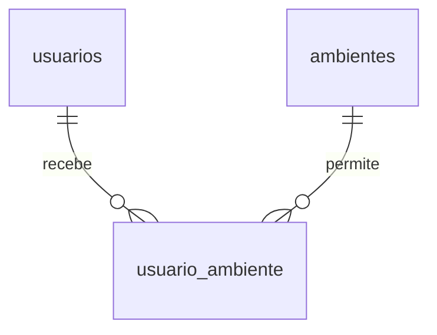

# Primeiro incremento do banco STOCKA

Este modelo ja acompanha o SQL implementado. O banco completo sera construido
em incrementos, sem alterar a instancia Supabase do grupo.

## Chaves e relacionamentos

PK identifica uma linha. FK referencia uma linha de outra tabela.

Um usuario pode ter zero ou varios ambientes, e um ambiente pode ter zero ou varios
usuarios. `usuario_ambiente` representa essa relacao N:N. O Administrador tem
acesso geral e nao depende de atribuicoes.

## usuarios

| Campo | Tipo | Papel |
|---|---|---|
| id | bigint identity | PK gerada pelo PostgreSQL. |
| nome | varchar(120) | Nome obrigatorio. |
| login | varchar(254) | Identificador unico de acesso; aceita o e-mail/login previsto na ERS. |
| senha_hash | text | Hash da senha; a senha original nao e armazenada. |
| perfil | varchar(20) | ADMINISTRADOR ou USUARIO. |
| ativo | boolean | Permite retirar acesso sem apagar a autoria anterior. |
| criado_em | timestamptz | Data e hora de criacao com informacao de fuso. |

## ambientes

| Campo | Tipo | Papel |
|---|---|---|
| id | bigint identity | PK gerada pelo PostgreSQL. |
| nome | varchar(120) | Nome unico, conforme RN02. |
| descricao | text | Descricao opcional. |
| tipo | varchar(10) | SALA ou SETOR. |
| ativo | boolean | Permite retirar de uso preservando referencias. |
| criado_em | timestamptz | Data e hora de criacao. |

## usuario_ambiente

| Campo | Tipo | Papel |
|---|---|---|
| usuario_id | bigint | FK para usuarios.id. |
| ambiente_id | bigint | FK para ambientes.id. |

A PK e o par `(usuario_id, ambiente_id)`. Assim, a mesma atribuicao nao e repetida.
As FKs bloqueiam exclusoes fisicas que deixariam atribuicoes sem usuario ou ambiente.

## Convencoes tecnicas propostas neste incremento

- Nomes de tabelas e campos em portugues, sem acentos, usando snake_case.
- Identificadores numericos gerados pelo banco, sem significado patrimonial.
- Login e nome de ambiente sao unicos sem diferenciar maiusculas e minusculas.
- Nomes e logins sao gravados sem espacos no inicio ou no fim.
- O limite de 120 caracteres para nomes e 254 para login e uma escolha tecnica,
  nao uma exigencia fornecida pela empresa.
- A descricao do ambiente foi tratada como opcional nesta primeira versao.
- A extensao pgcrypto e usada apenas para preparar e verificar os hashes dos testes.
  A API Java ja valida credenciais e administra sessoes; veja backend.md.

## O que esta garantido e o que ainda depende da API

O banco ja garante campos obrigatorios, perfis e tipos permitidos, unicidade,
atribuicoes sem duplicacao e referencias a usuarios e ambientes existentes.
A consulta da API retorna todos os ambientes ativos para o administrador,
somente os atribuidos para o usuario comum e nenhum para uma conta desativada.

Essa consulta nao e um mecanismo de seguranca instalado sobre todas as tabelas.
Quem administra diretamente o PostgreSQL continua podendo consultar os dados.
A API Java devera usar a identidade autenticada, validar acesso em cada requisicao,
validar a senha minima da RN06 e impedir desativacao ou rebaixamento do ultimo
administrador. Desativacao tambem devera bloquear requisicoes de sessoes existentes.
Usuarios desativados nao sao apagados. A reativacao nao foi implementada como funcionalidade.

Itens, OS, manutencoes, movimentacoes e auditoria ainda nao possuem tabelas neste
incremento. Portanto, as regras sobre seus vinculos nao estao implementadas.
Quando esses modulos forem adicionados, a desativacao de ambientes tambem devera
verificar localizacao e responsabilidade antes de salvar a alteracao.

## Complemento: identidade visual dos ambientes

V002 acrescenta à tabela ambientes o campo cor: varchar(12), NOT NULL,
DEFAULT TERRACOTA, com CHECK para TERRACOTA/AZUL/VERDE/VIOLETA/GRAFITE.
Não acrescenta relações nem modifica PKs/FKs. Essa melhoria visual foi aprovada
pelo usuário; não é requisito funcional adicional da empresa e não indica status.
Nome e tipo seguem independentes da cor. A atualização preserva todos os dados.

O DAO agora também cadastra/edita ambientes e substitui atribuições por ambiente
em uma transação. A API exige administrador ativo para essas ações. Ainda não há
retirada de ambiente; suas dependências de inventário e responsabilidade serão
implementadas junto dos módulos correspondentes para cumprir RF13/RN05.
